# Install AAGearUP with KingInstaller + Shizuku

For phones where the classic [KingInstaller method](INSTALL.md) doesn't work: AAGearUP installs, but Android Auto doesn't show it. Tested on a Google Pixel 10 Pro. About twenty minutes.

**[⬇ Download AAGearUP.apk](https://github.com/lsprobe/AAGearUP/releases/latest/download/AAGearUP.apk)** · [KingInstaller releases](https://github.com/fcaronte/KingInstaller/releases) · [Shizuku on Google Play](https://play.google.com/store/apps/details?id=moe.shizuku.privileged.api) · [This guide on aagearup.com](https://aagearup.com/install-shizuku)

Tested with KingInstaller v2.4, Shizuku 13.5 and Android Auto 17.9.

> **⚠️ Before you start**  
> If AAGearUP is already installed (for example from the classic guide), **uninstall it first**. Install it **only with KingInstaller**, never by tapping the APK in your browser or file manager.

## 1. Pause the phone’s install blockers

These two protections stop apps from outside the Play Store. Switch them off for the install; you’ll turn them back on in step 9.

### Samsung Auto Blocker (Samsung only)

1. Open **Settings** → **Security and privacy** → **Auto Blocker**.
2. Turn the switch **Off**.

> **⏱️ It turns itself back on**  
> On One UI 8.5 and newer, Auto Blocker switches back on after about 30 minutes. If the install gets stuck, check it first.

### Google Play Protect

1. Open the **Google Play Store**.
2. Tap your profile picture (top right) → **Play Protect**.
3. Tap the gear icon ⚙ (top right).
4. Turn off **Scan apps with Play Protect**.
5. In the dialog choose **Pause**. Scanning then comes back on by itself the next day.
6. Also turn off **Improve harmful app detection**.

  

## 2. Install KingInstaller

Already have KingInstaller from the classic guide? Check that both permissions are on and go to step 3.

1. In your phone’s browser, download the latest KingInstaller APK from its [GitHub Releases page](https://github.com/fcaronte/KingInstaller/releases), in the **Assets** list. This guide uses v2.4.
2. Open the downloaded file and install it. If the phone asks to allow installs from this source, allow it for your browser.
3. Download [AAGearUP.apk](https://github.com/lsprobe/AAGearUP/releases/latest/download/AAGearUP.apk) and leave it in **Downloads**. **Don’t open it.**
4. Open KingInstaller. It asks for two permissions; turn on **Allow permission** for both:
   - **All files access**, so it can see the APK file;
   - **Install unknown apps**, so it can install it.

> **⏱️ These switches are still off in the screenshots**  
> They show the screen before you tap. Switch them on.

 

## 3. Turn on Developer options and install Shizuku

### Developer options

1. Open **Settings** → **About phone** (on Samsung also **Software information**).
2. Tap **Build number** **7 times** until you see “You are now a developer”. Enter your PIN if asked.
3. **Developer options** now appears under **Settings** → **System** (Pixel) or at the bottom of Settings (Samsung).

### Shizuku

1. In the Google Play Store search for **Shizuku** (by Xingchen & Rikka) and tap **Install**.

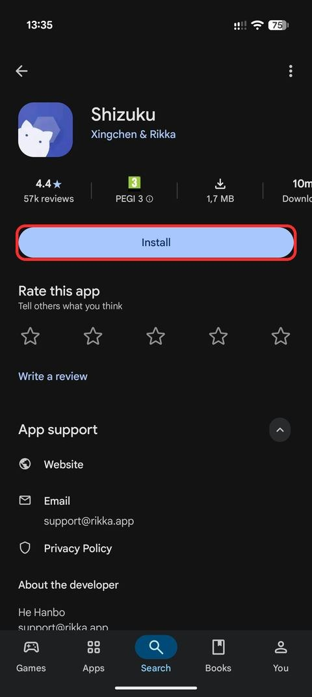

## 4. Pair and start Shizuku

Shizuku starts through **Wireless debugging**, so the phone must be on **Wi-Fi**. The red frame on each screenshot shows where to tap.

### Allow Shizuku notifications

You enter the pairing code in a Shizuku notification, so notifications must be on.

1. Open Shizuku. Under **Start via Wireless debugging** tap **Pairing**.
2. If a red banner says notifications are needed, tap **Notification options**.
3. Turn on **All Shizuku notifications**, then go back.

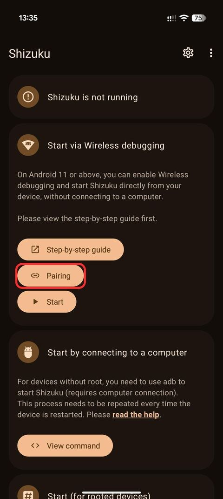 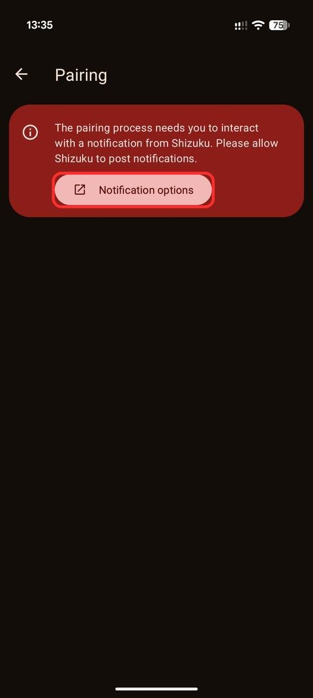 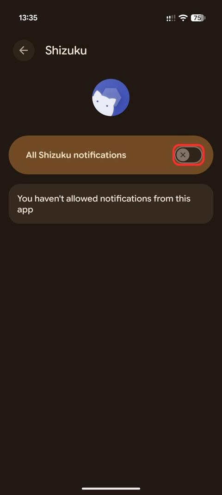 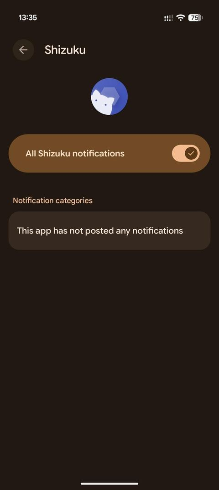

### Turn on Wireless debugging

1. Back on the Shizuku pairing screen a notification “Searching for pairing service” appears. Tap **Developer options** on that screen.
2. Scroll down to **Wireless debugging** and turn its **switch** on.
3. In **Allow wireless debugging?** tap **OK**.
4. In **Allow wireless debugging on this network?** tap **Allow**. Ticking “Always allow on this network” saves a step next time.

> **⏱️ Samsung: “Blocked by Auto Blocker”**  
> If Wireless debugging is greyed out, Auto Blocker has switched back on. Turn it off again (step 1).

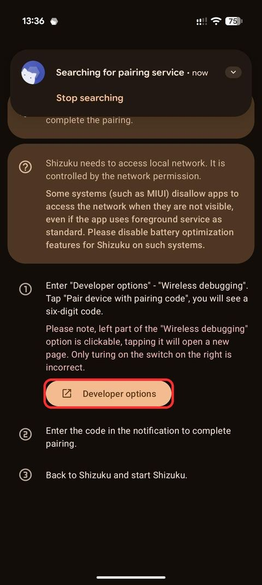 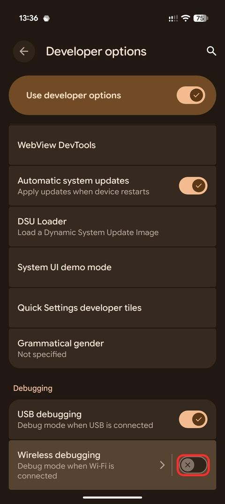 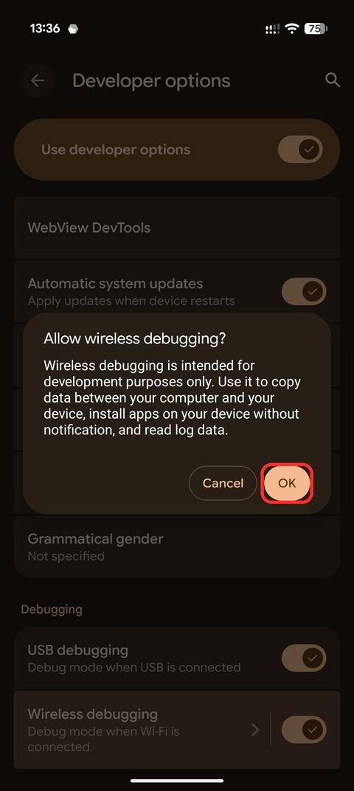 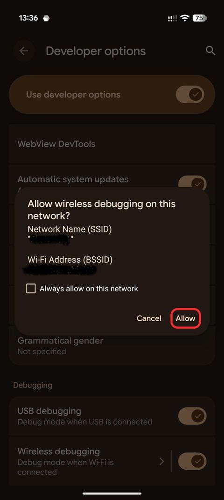

### Pair Shizuku with a code

1. Tap the **text** **Wireless debugging** (not the switch) to open its page.
2. Tap **Pair device with pairing code**. A 6-digit code appears. **Keep this dialog open.**
3. Pull down the notification shade. In the Shizuku notification **Pairing service found** tap **Enter pairing code**.
4. Type the 6-digit code and tap **Send**. A notification confirms the pairing.

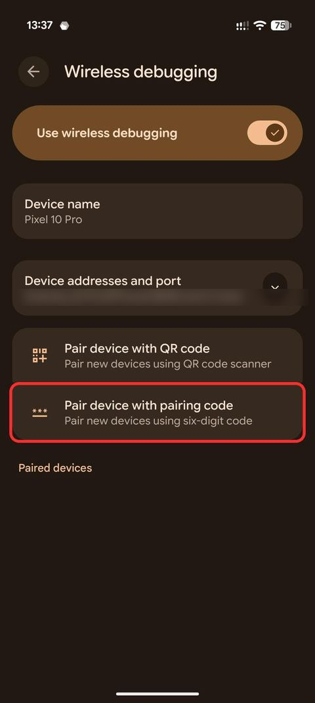 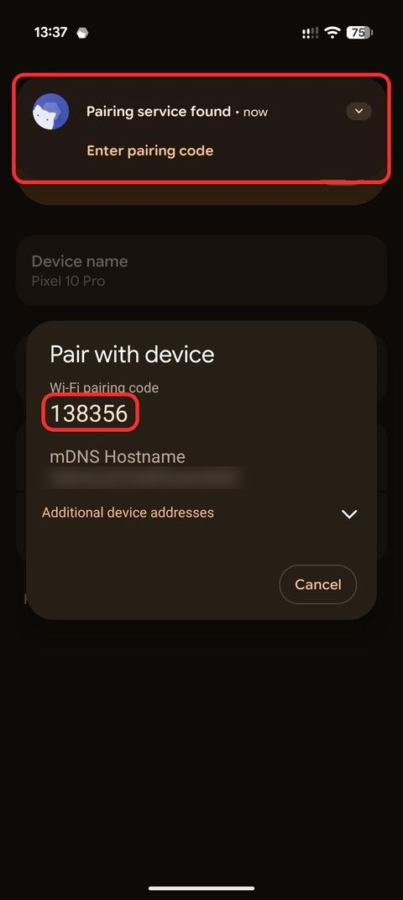

### Start Shizuku

1. Go back to Shizuku and tap **Start**.
2. A “Starter” log window opens and closes by itself after “Service started”.
3. The top of the app now shows **Shizuku is running**.

 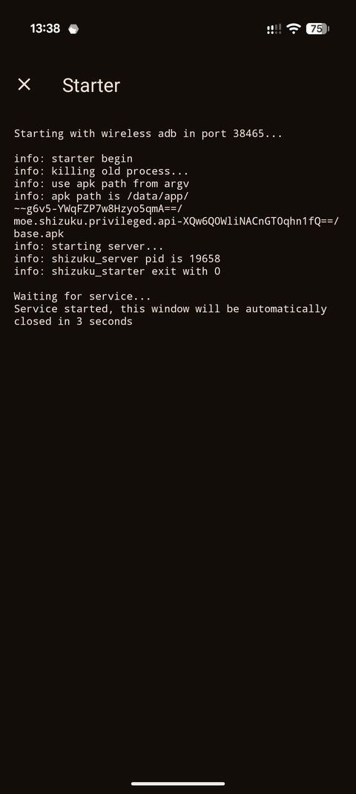 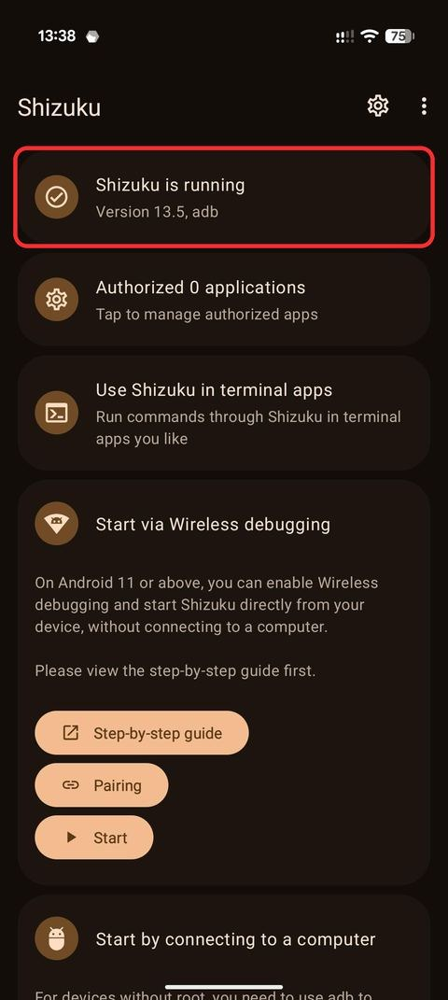

## 5. Install AAGearUP with KingInstaller + Shizuku

1. Open KingInstaller (the permissions from step 2 must be on).
2. Tap **Select APK to install** and pick **AAGearUP.apk**.
3. Under **Installation Method** turn on **Shizuku** (leave Root off).
4. If Shizuku asks for permission for KingInstaller, tap **Allow all the time**.
5. Tap **Install as king**, then **Install** in the system dialog.

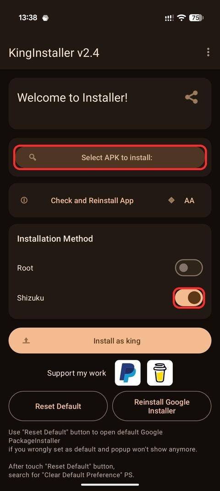 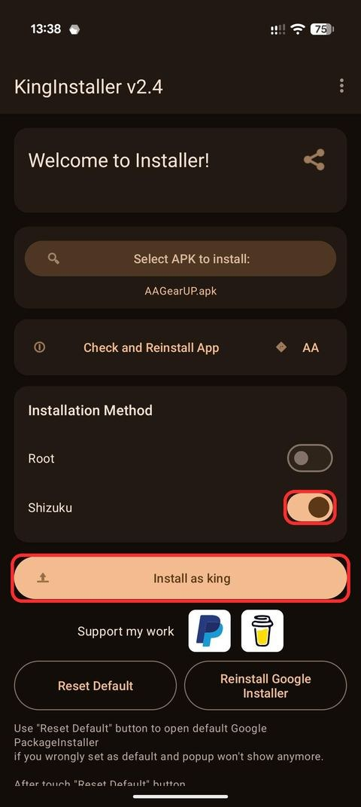 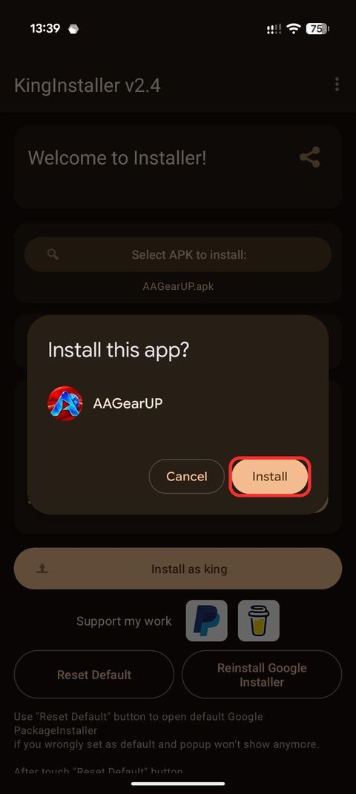

> **⚠️ Xiaomi, POCO, Redmi (MIUI / HyperOS)**  
> These phones ignore or block the installer information, so Shizuku without root does **not** work there. Use the [classic guide](INSTALL.md). If that fails too, only **Root** mode in KingInstaller (or Shizuku started with root) works. Vivo has also been reported as problematic (unconfirmed).

## 6. Turn on Android Auto developer settings

Android Auto has its own hidden developer mode, and **you need it with Shizuku too**: Shizuku makes AAGearUP look like a Play Store install, while Android Auto’s **Unknown sources** decides whether it may run in the car.

1. Open the Android Auto settings: **Settings** → search **Android Auto**. Or **Settings** → **Apps** → **Android Auto** → **Configure in Android Auto**.
2. Scroll to the bottom, to **Version and permission info**.
3. Tap this heading **10 times** until it offers to enable developer settings, then tap **OK**. The package list under it should include **AAGearUP** with its version.
4. Tap the ⋮ menu (top right) → **Developer settings**.
5. Tick **Unknown sources**.
6. If you see **Application Mode**, you can set it to **Developer**. Usually not needed.

  

## 7. Add AAGearUP to the car launcher

1. Back in the Android Auto settings open **Display** → **Customize launcher**.
2. Tick **AAGearUP**.
3. Drag it higher in the list if you want it near the top.

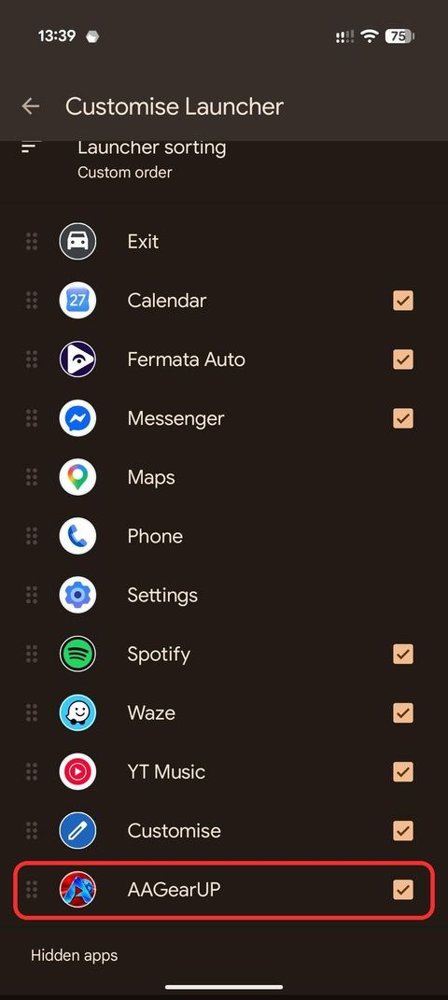

## 8. Open it in the car

1. Connect the phone to the car, with a cable or wireless Android Auto.
2. Open **AAGearUP** from the Android Auto app list.
3. On the phone, allow AAGearUP access to the car speed (Android shows it as Location). Your 14-day free trial starts.

Set up your favorites and theme before you drive, and keep your attention on the road.

## 9. Clean up

Once AAGearUP works in the car, put your phone’s protections back:

1. **Auto Blocker**: **Settings** → **Security and privacy** → **Auto Blocker** → **On**.
2. **Play Protect**: Play Store → profile → Play Protect → ⚙ → turn both switches back on.
3. **Install unknown apps**: **Settings** → search **Install unknown apps** → remove it from your browser, file manager and KingInstaller.
4. **All files access**: remove it from KingInstaller (search **All files access**).
5. **Shizuku**: in Developer options turn off **Wireless debugging**. You can stop or uninstall Shizuku, and turn Developer options off entirely. This doesn’t affect Android Auto’s own developer settings.
6. Keep KingInstaller if you want to install updates later; otherwise you can uninstall it and install it again when needed.

> **⚠️ Leave Android Auto’s developer settings on**  
> “Unknown sources” in Android Auto must stay ticked, or AAGearUP disappears from the car screen.

> **ℹ️ Shizuku is only needed for installing**  
> Once installed, AAGearUP works without Shizuku. On a phone without root, Shizuku stops after every reboot; start it again through Wireless debugging (no new pairing) only when you install or update AAGearUP. KingInstaller’s author recommends **Shizuku-Next**, a fork on GitHub by rushiranpise that can start automatically without Wi-Fi.

## Updates

Start Shizuku, download the new [AAGearUP.apk](https://github.com/lsprobe/AAGearUP/releases/latest/download/AAGearUP.apk) and install it with KingInstaller (Shizuku on) over the existing app, as in step 5. Don’t uninstall first: favorites, settings and your license stay.

## Your license

Every feature is free for 14 days. To keep using AAGearUP, open it on your phone and tap **Unlock AAGearUP → Buy license** (€3.99 one-time); it activates automatically. On a new phone or after reinstalling, tap **Restore purchase** and enter the key from your receipt email.

## Troubleshooting

**The install is blocked or nothing happens.** Auto Blocker has probably switched itself back on. Turn it off and try again.

**AAGearUP is installed but not in Customize launcher.** Shizuku wasn’t running, or the Shizuku switch in KingInstaller was off when you tapped “Install as king”. Uninstall AAGearUP and repeat step 5.

**No “Enter pairing code” notification.** Shizuku notifications are off, or the pairing dialog was closed. Keep the 6-digit code dialog open while you enter the code in the notification.

**“Shizuku is not running”.** After a reboot or a Wi-Fi change, turn Wireless debugging on again and tap Start in Shizuku. You usually don’t need to pair again.

**Xiaomi: “Caller does not have same cert as new installer package”.** Shizuku without root can’t set Google Play as the installer on MIUI / HyperOS. Use Root mode.

**It’s in the list but not in the car.** Check that **Unknown sources** is ticked in Android Auto developer settings and that AAGearUP is ticked in the launcher. Disconnect and reconnect the phone.

**It disappeared after an Android Auto update.** Check that the developer settings are still on. If needed, use **Check and Reinstall App** in KingInstaller or install AAGearUP again (Shizuku must be running).

**The car screen says “Waiting for speed data”.** Open AAGearUP on the phone and tap **Allow car speed access**, or allow it in **Settings** → **Apps** → **AAGearUP** → **Permissions** → **Location**.

**Still stuck?** Ask in the [community forum](https://github.com/lsprobe/AAGearUP/discussions) or write to [support@aagearup.com](mailto:support@aagearup.com) with your phone model, Android version and car or head unit.

KingInstaller and Shizuku are independent third-party apps and not part of AAGearUP. AAGearUP is not affiliated with or endorsed by Google. Android Auto is a trademark of Google LLC.
