# Install AAGearUP

With KingInstaller, in about ten minutes. Written for Samsung (One UI) phones; on other phones skip the Auto Blocker step.

**[⬇ Download AAGearUP.apk](https://github.com/lsprobe/AAGearUP/releases/latest/download/AAGearUP.apk)** · [KingInstaller releases](https://github.com/fcaronte/KingInstaller/releases) · [This guide on aagearup.com](https://aagearup.com/install.html)

Tested with KingInstaller v2.4 and Android Auto 17.9.

> **⚠️ The one rule that matters**  
> Don’t install AAGearUP.apk by tapping it in your browser or file manager. Install it **only with KingInstaller**. Otherwise the app installs, but Android Auto won’t show it.

## 1. Pause the phone’s install blockers

These two protections stop apps from outside the Play Store. Switch them off for the install; you’ll turn them back on in step 7.

### Samsung Auto Blocker

1. Open **Settings** → **Security and privacy** → **Auto Blocker**.
2. Turn the switch **Off**.

> **⏱️ It turns itself back on**  
> On One UI 8.5 and newer, Auto Blocker switches back on after about 30 minutes. If the install gets stuck, check it first.

### Google Play Protect

1. Open the **Google Play Store**.
2. Tap your profile picture (top right) → **Play Protect**.
3. Tap the gear icon ⚙ (top right).
4. Turn off **Scan apps with Play Protect**.
5. In the dialog choose **Pause**. Scanning then comes back on by itself the next day.
6. Also turn off **Improve harmful app detection**.

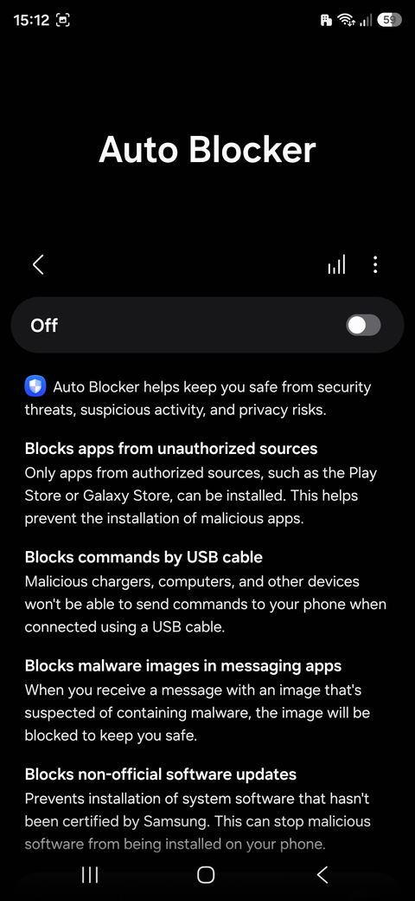 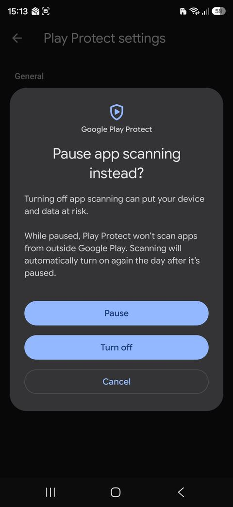 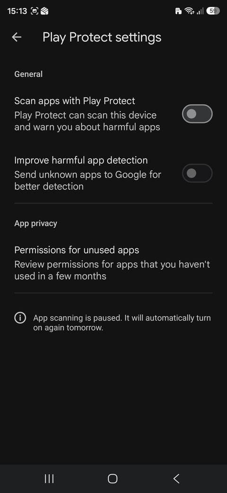

## 2. Install KingInstaller

1. In your phone’s browser, download the latest KingInstaller APK from its [GitHub Releases page](https://github.com/fcaronte/KingInstaller/releases), in the **Assets** list. This guide uses v2.4.
2. Open the downloaded file and install it. If the phone asks to allow installs from this source, allow it for your browser.
3. Download [AAGearUP.apk](https://github.com/lsprobe/AAGearUP/releases/latest/download/AAGearUP.apk) and leave it in **Downloads**. **Don’t open it.**
4. Open KingInstaller. It asks for two permissions; turn on **Allow permission** for both:
   - **All files access**, so it can see the APK file;
   - **Install unknown apps**, so it can install it.

> **⏱️ These switches are still off in the screenshots**  
> They show the screen before you tap. Switch them on.

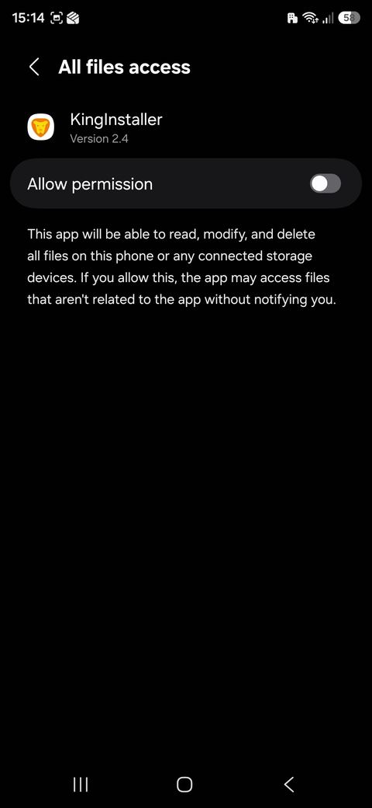 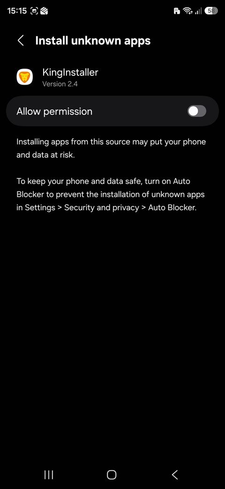

## 3. Install AAGearUP with KingInstaller

1. In KingInstaller tap **Select APK to install** and pick **AAGearUP.apk** from Downloads. The file name appears under the button.
2. Under **Installation Method** leave **Root** and **Shizuku** off. On Samsung phones with KingInstaller v2.4 that’s all you need.
3. Tap **Install as king**.
4. In the system dialog **Install this app?** tap **Install**.

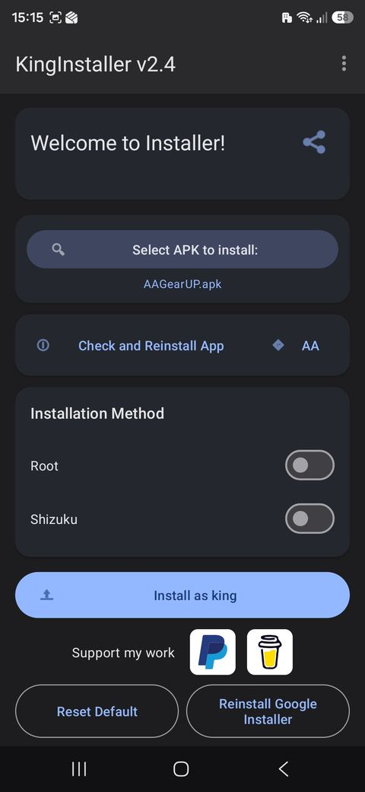 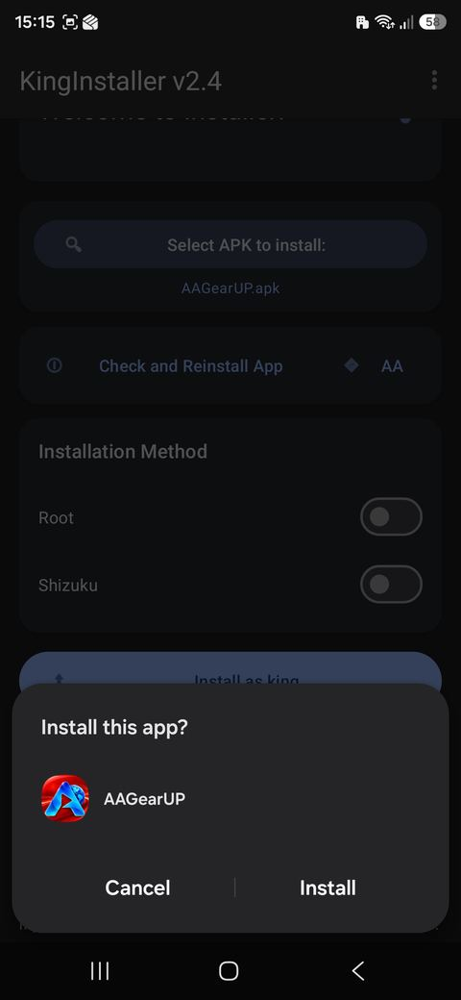

> **ℹ️ Already installed another way?**  
> Uninstall AAGearUP first, then repeat this step. A copy installed from the browser won’t work in Android Auto.

## 4. Turn on Android Auto developer settings

Android Auto has its own hidden developer mode. Without it, apps from outside Google Play don’t show on the car screen.

1. Open the Android Auto settings: **Settings** → search **Android Auto**. Or **Settings** → **Apps** → **Android Auto** → **Configure in Android Auto**.
2. Scroll to the bottom, to **Version and permission info**.
3. Tap this heading **10 times** until it offers to enable developer settings, then tap **OK**. The package list under it should include **AAGearUP** with its version.
4. Tap the ⋮ menu (top right) → **Developer settings**.
5. Tick **Unknown sources**.
6. If you see **Application Mode**, you can set it to **Developer**. Usually not needed.

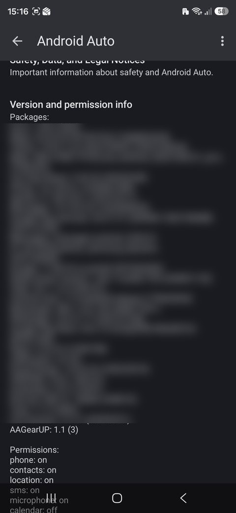 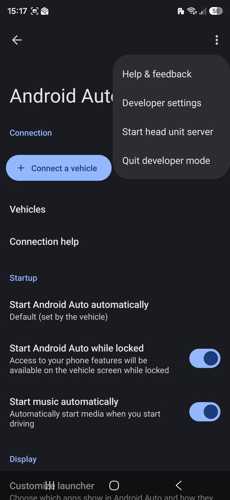 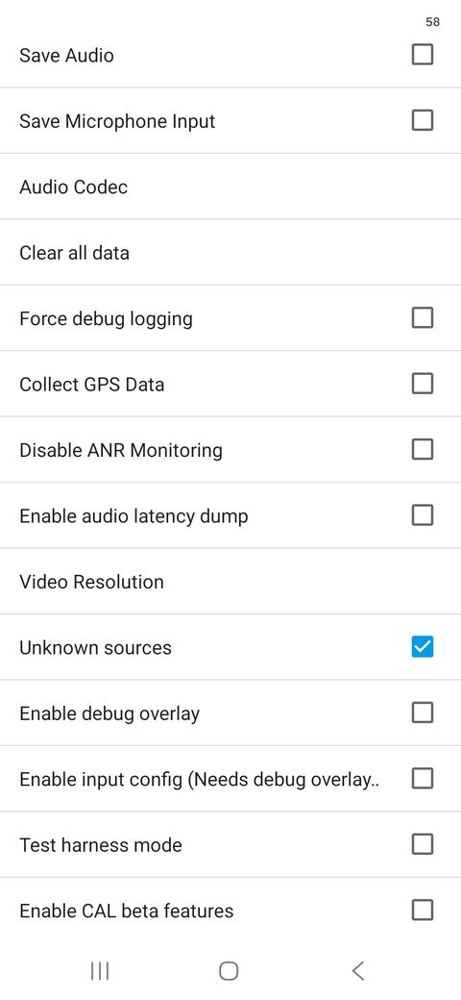

## 5. Add AAGearUP to the car launcher

1. Back in the Android Auto settings open **Display** → **Customize launcher**.
2. Tick **AAGearUP**.
3. Drag it higher in the list if you want it near the top.

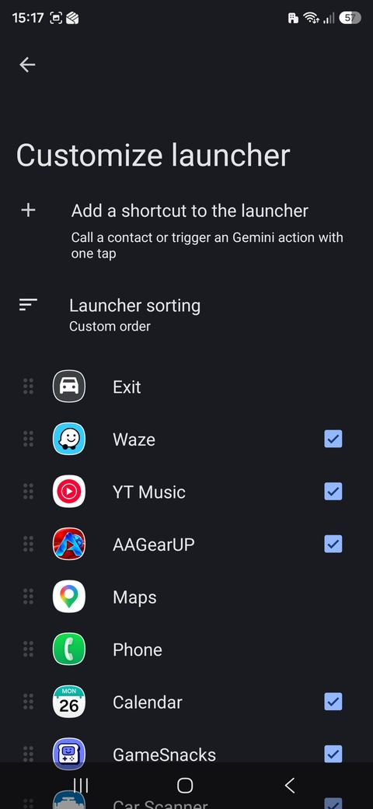

## 6. Open it in the car

1. Connect the phone to the car, with a cable or wireless Android Auto.
2. Open **AAGearUP** from the Android Auto app list.
3. On the phone, allow AAGearUP access to the car speed (Android shows it as Location). Your 14-day free trial starts.

Set up your favorites and theme before you drive, and keep your attention on the road.

## 7. Clean up

Once AAGearUP works in the car, put your phone’s protections back:

1. **Auto Blocker**: **Settings** → **Security and privacy** → **Auto Blocker** → **On**.
2. **Play Protect**: Play Store → profile → Play Protect → ⚙ → turn both switches back on.
3. **Install unknown apps**: **Settings** → search **Install unknown apps** → remove it from your browser, file manager and KingInstaller.
4. **All files access**: remove it from KingInstaller (search **All files access**).
5. Keep KingInstaller if you want to install updates later; otherwise you can uninstall it and install it again when needed.

> **⚠️ Leave Android Auto’s developer settings on**  
> “Unknown sources” in Android Auto must stay ticked, or AAGearUP disappears from the car screen.

## Updates

Download the new [AAGearUP.apk](https://github.com/lsprobe/AAGearUP/releases/latest/download/AAGearUP.apk) and install it with KingInstaller over the existing app, the same way as in step 3. Don’t uninstall first: favorites, settings and your license stay.

## Your license

Every feature is free for 14 days. To keep using AAGearUP, open it on your phone and tap **Unlock AAGearUP → Buy license** (€3.99 one-time); it activates automatically. On a new phone or after reinstalling, tap **Restore purchase** and enter the key from your receipt email.

## Troubleshooting

**The install is blocked or nothing happens.** Auto Blocker has probably switched itself back on. Turn it off and try again.

**AAGearUP is installed but not in Customize launcher.** It wasn’t installed with KingInstaller. Uninstall it and repeat step 3.

**It’s in the list but not in the car.** Check that **Unknown sources** is ticked in Android Auto developer settings and that AAGearUP is ticked in the launcher. Disconnect and reconnect the phone.

**It disappeared after an Android Auto update.** Check that the developer settings are still on. If needed, use **Check and Reinstall App** in KingInstaller or install AAGearUP again.

**Not a Samsung phone.** Skip the Auto Blocker step; everything else is the same. If the install doesn’t work, use KingInstaller’s **Shizuku** method: install [Shizuku](https://play.google.com/store/apps/details?id=moe.shizuku.privileged.api), start it via **Wireless debugging** in Developer options, then select **Shizuku** under Installation Method in KingInstaller.

**The car screen says “Waiting for speed data”.** Open AAGearUP on the phone and tap **Allow car speed access**, or allow it in **Settings** → **Apps** → **AAGearUP** → **Permissions** → **Location**.

**Still stuck?** Ask in the [community forum](https://github.com/lsprobe/AAGearUP/discussions) or write to [support@aagearup.com](mailto:support@aagearup.com) with your phone model, Android version and car or head unit.

KingInstaller and Shizuku are independent third-party apps and not part of AAGearUP. AAGearUP is not affiliated with or endorsed by Google. Android Auto is a trademark of Google LLC.
