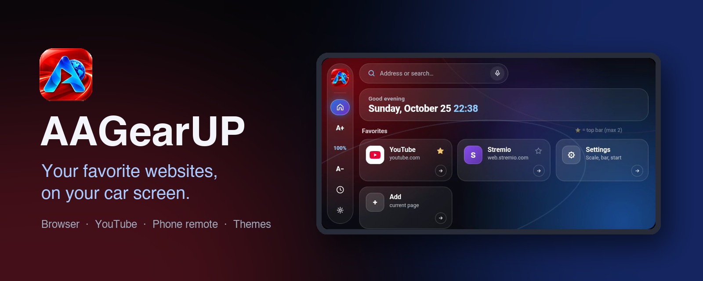

  

  <a href="https://github.com/lsprobe/AAGearUP/releases/latest/download/AAGearUP.apk"><b>⬇ Download AAGearUP</b></a>
  &nbsp;·&nbsp;
  <a href="INSTALL.md"><b>Install guide</b></a>
  &nbsp;·&nbsp;
  <a href="https://aagearup.com">aagearup.com</a>
  &nbsp;·&nbsp;
  <a href="https://github.com/lsprobe/AAGearUP/discussions">Community</a>

  
  
  
  

---

## The web, made for your dashboard

**AAGearUP turns your Android Auto screen into a real web browser and personal home screen.**
Open YouTube, Stremio, news or any website you like, keep your favorite sites one tap away, and control it all from the car screen or from your phone.

No new subscriptions, no complicated setup: install it once, sign in with your own accounts, and your car screen is ready.

- 🌐 **A full browser in the car** — any website, with the Android Auto keyboard or voice search.
- ⭐ **Your own home screen** — favorite sites with icons, recent pages and *Continue* right where you left off.
- 🎛️ **Steering-wheel control** — play/pause and skip YouTube videos with your steering-wheel buttons, jump ±10 seconds.
- ▶️ **One tap to fullscreen** — AAGearUP finds the video on any web page; one button and it plays fullscreen.
- 🔊 **Audio in sync over wireless** — on wireless Android Auto the sound can lag; delay or advance it until lips match.
- 📱 **Phone companion** — browse on the phone and send the page to the car, or use the phone as a YouTube remote.
- 🎨 **Make it yours** — six color themes and screen scale from 60 % to 150 %.
- 🚗 **Fits every Android Auto screen** — from compact 800 × 480 units to HD and widescreen displays.

## Screenshots

<table>
  <tr>
    <td width="50%"> <b>Home screen</b> Favorites, <i>Continue</i> and search in one place.</td>
    <td width="50%"> <b>Themes and settings</b> Colors, scale and video fit, right on the car screen.</td>
  </tr>
  <tr>
    <td colspan="2" align="center"> <b>Phone app</b> Favorites, sign-ins and remote control.</td>
  </tr>
</table>

## Everything you need

| | |
|---|---|
| **Browse** | YouTube, Stremio and any website in a full browser, with back, reload and scroll buttons sized for a car screen. |
| **Pick up where you left off** | *Continue* returns to your last site and video position, even after the car was switched off. |
| **YouTube, adapted** | Wider layout with more videos per row, compact bottom bar, automatic *Skip ad* when it appears. |
| **Steering-wheel buttons** | Control YouTube with the buttons on your steering wheel: play/pause, previous and next video. |
| **Playback controls** | Jump back or forward 10 seconds, previous / next track and play/pause on the car screen. |
| **Video on any site** | AAGearUP detects the video on the web page you open. Press one button and it goes fullscreen. |
| **Video size** | Fill the screen, show the whole frame or stretch – choose how video fits your display. |
| **Audio sync** | Wireless Android Auto can delay the sound. Shift the audio later or earlier (±500 ms), with a built-in test video. |
| **Phone companion** | *Show in car*, *Follow* mode and a YouTube remote. Sign in once on the phone, the car screen is signed in too. |
| **Look & feel** | Dark glass design, six themes, adjustable scale, audio/video sync, start page of your choice. |

## Get started in a few minutes

1. **[Download AAGearUP.apk](https://github.com/lsprobe/AAGearUP/releases/latest/download/AAGearUP.apk)** to your Android phone.
2. **Install it with KingInstaller** so Android Auto lists the app.
3. **Turn it on** in *Android Auto → Customize launcher*, connect to your car and open AAGearUP.

📖 **The complete step-by-step guide with screenshots, including the Shizuku option and troubleshooting: [INSTALL.md](INSTALL.md)** (also on [aagearup.com/install](https://aagearup.com/install.html)).

**Updating:** install the new APK the same way, over the existing app. Your favorites, settings and license stay.

## Try it free, then keep it

- **14-day free trial** — no payment card, no automatic charge.
- **€3.99 one-time license**, taxes included. No subscription. One active device.
- Buy right in the app: *Unlock AAGearUP → Buy license*. It activates automatically.
- New phone or reinstall? *Restore purchase* with the key from your receipt email.

## Requirements

- Android phone with **Android 8.0** or newer and **Android Auto**
- A car or head unit with Android Auto (wired or wireless)
- Internet connection on the phone

## Community and support

- 💬 **[Discussions](https://github.com/lsprobe/AAGearUP/discussions)** — share your car and phone setup, ideas and tips.
- 🐞 **[Issues](https://github.com/lsprobe/AAGearUP/issues)** — report a bug or something that doesn’t work. Please include your phone model, Android version and car or head unit.
- ✉️ **support@aagearup.com** — licenses, purchases and private questions.

## Trust

AAGearUP is installed outside Google Play, so Android may show a warning while installing. Every release lists the **SHA-256** checksum of the APK, so you can verify the exact file you downloaded.

AAGearUP is an independent project and is not affiliated with or endorsed by Google. Android Auto is a trademark of Google LLC.

## License

Proprietary software. Free 14-day trial, paid license for continued use. Source code is not public; no redistribution, modification or resale. See [LICENSE.txt](LICENSE.txt), [Terms](https://aagearup.com/terms.html) and [Privacy](https://aagearup.com/privacy.html).
