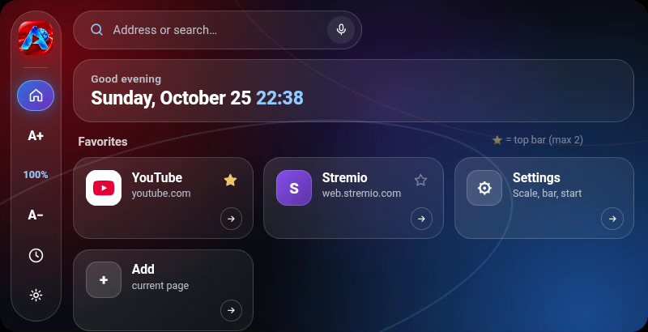
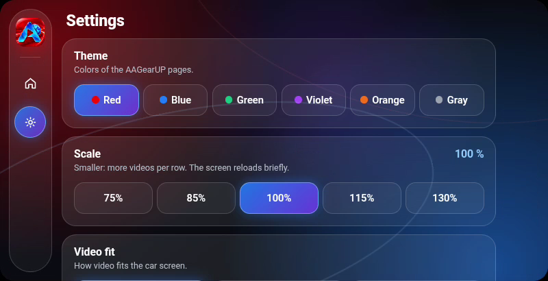
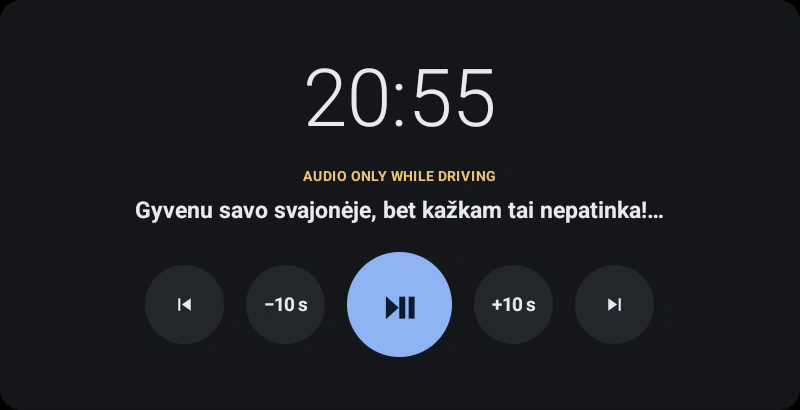
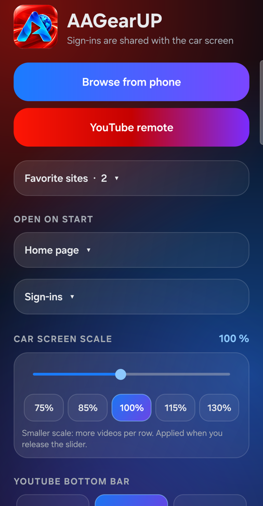
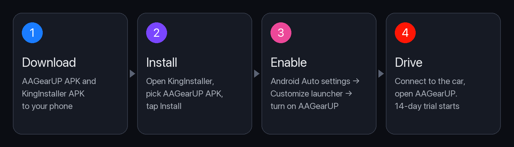

# AAGearUP

Web browser and launcher for Android Auto. Your favorite websites, YouTube and video on the car screen while parked; audio with a calm screen while driving.

**[⬇ Download the latest release](https://github.com/lsprobe/AAGearUP/releases/latest)** · [aagearup.com](https://aagearup.com)

## What it is

AAGearUP puts a real web browser on your Android Auto screen. Pin the sites you use, open YouTube or your streaming service, and control everything from the car screen or from your phone. When the car starts moving, video is hidden automatically and the music keeps playing.

## Screenshots

**1. Home screen with your favorite sites**

**2. Themes, scale and video settings**

**3. While driving: audio only, clock and a calm equalizer**

**4. Phone companion: browse on the phone, show it in the car**

## Why it is different

- **A full browser in the car** – any website, signed in with your own accounts.
- **Made for parking breaks** – YouTube and video on the big screen while parked.
- **Safe while driving** – video is hidden as soon as the car moves; audio, clock and playback controls stay.
- **Phone companion** – type and search on the phone, send the page to the car, use the phone as a YouTube remote.
- **Six color themes**, adjustable screen scale and audio/video sync.

## Install

AAGearUP is not on Google Play. Android Auto shows only apps installed from Play, so AAGearUP is installed with **KingInstaller**.

1. **Download** `AAGearUP.apk` from [Releases](https://github.com/lsprobe/AAGearUP/releases/latest) and the KingInstaller APK to your phone.
2. **Install KingInstaller.** Open the file; if Android asks, allow *Install unknown apps* for your browser or Files app.
3. **Install AAGearUP with KingInstaller:** open KingInstaller, pick the AAGearUP APK, tap *Install*.
4. **Show it in the car:** phone *Settings → Android Auto → Customize launcher* → turn on **AAGearUP**.
5. **Drive:** connect to the car and open AAGearUP. The 14-day free trial starts (internet required).

Not visible in the car? In Android Auto settings tap *Version* 10 times, then *⋮ → Developer settings → Unknown sources* → on, and reconnect the phone.

**Update:** install the new APK the same way, over the old one. Your settings and license stay.

## License and price

- 14-day free trial, no payment card.
- **€3.99 one-time**, taxes included. One active device per license, no subscription.
- Buy in the app: *Unlock AAGearUP → Buy license*. It activates automatically.
- New phone or reinstall: *Restore purchase* with the key from your receipt email.

## Requirements

- Android phone with Android 8.0 or newer and Android Auto.
- A car or head unit with Android Auto.
- Internet connection on the phone.

## A note on trust

AAGearUP is installed outside Google Play, so Android may show a warning during installation. Each release lists the SHA-256 checksum of the APK so you can verify the exact file you downloaded.

AAGearUP is an independent project and is not affiliated with or endorsed by Google. Android Auto is a trademark of Google LLC.

## License

Proprietary software. Free 14-day trial, paid license for continued use. Source code is not public; no redistribution, modification or resale. See [LICENSE.txt](LICENSE.txt), [Terms](https://aagearup.com/terms.html) and [Privacy](https://aagearup.com/privacy.html).

Support: support@aagearup.com
